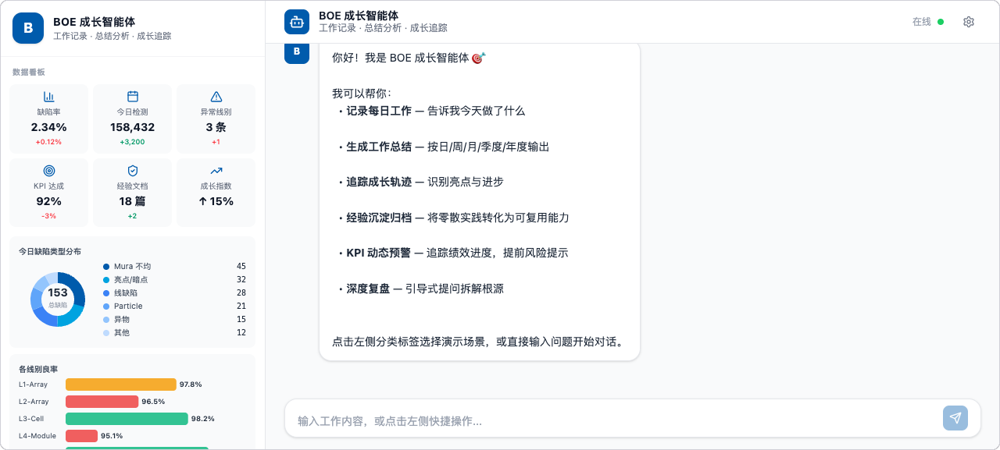
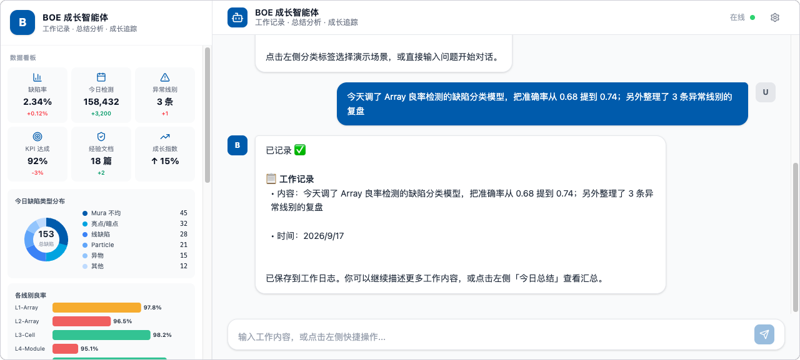

# BOE Growth Agent

A conversational prototype for work notes and summaries, built with React, Express and the Coze API.

[中文](README.md)

Enter work items or request daily, weekly, monthly, quarterly and yearly summaries using the shortcuts. Without Coze credentials, the backend returns local demo replies so you can preview the interaction.



## Current Status

This is a personal prototype, not an official BOE product. The dashboard uses sample data and is not connected to production systems. Chat messages live in page memory and reset on refresh. A work-log database, cross-session retrieval and report statistics are not implemented. Record counts, hours and “saved” messages in demo replies are illustrative text.

With Coze connected, replies depend on the bot you configure. The application itself does not guarantee consistent reports across periods or persistent work-log storage.



## Run Locally

Requires Node.js **20.19+ or 22.12+**, as required by the current Vite dependencies, and npm.

```bash
npm install
npm run start
```

Open <http://localhost:5173>. The `start` script launches both Vite and the Express backend, which defaults to port `3001`. Running `npm run dev` alone starts only the frontend.

## Connect Coze

Enter the API base URL, token and bot ID in the settings dialog, or create a `.env` file in the project root:

```env
COZE_API_BASE=https://api.coze.cn
COZE_API_TOKEN=your_api_token_here
COZE_BOT_ID=your_bot_id_here
```

Non-empty values from the settings dialog override environment variables. A missing token or bot ID selects demo mode. Failed requests with configured credentials return an error message.

Settings are stored in browser `localStorage`. When sending a message, the frontend sends the settings and current conversation to this project's Express backend, which then calls the configured Coze endpoint.

## Project Structure

```text
src/
  App.jsx                   Conversation state and requests
  components/               Header, dashboard, chat and settings
server/index.js             Coze v3 calls and local demo replies
assets/                     README screenshots
vite.config.js              Frontend configuration and /api proxy
```

The frontend uses React 19, Vite, Tailwind CSS 4 and Lucide React. The backend uses Express 5.

```bash
npm run build
npm run lint
```

## Licence

The project is documented as MIT, but the repository does not yet include a standalone LICENSE file.
