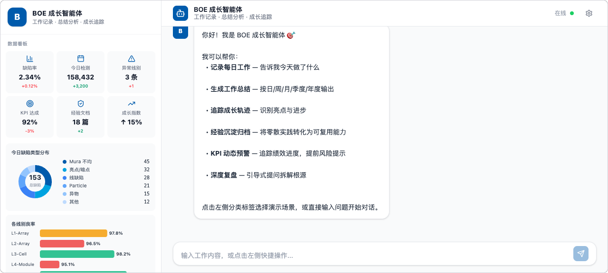
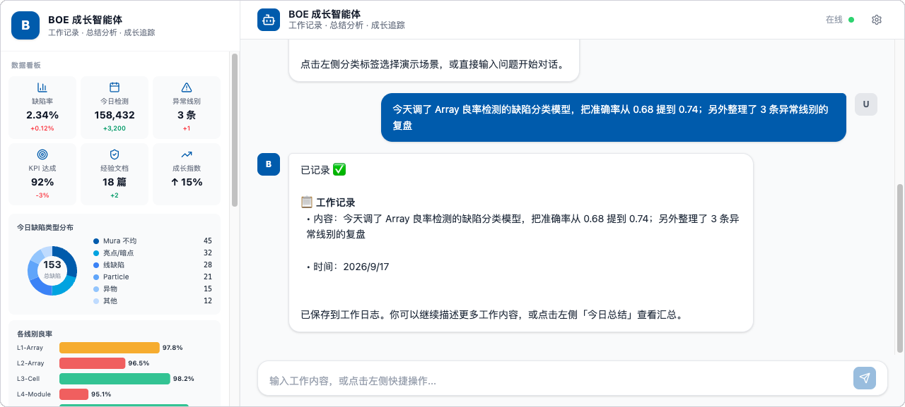

# BOE 成长智能体

工作记录与总结的对话界面原型，使用 React、Express 和 Coze API。

[English](README.en.md)

可以输入工作事项，或用快捷入口请求日、周、月、季度和年度总结。未配置 Coze 时，后端会返回本地演示回复，便于预览交互。



## 当前状态

这是个人原型项目，并非京东方官方产品。看板使用示例数据，没有连接产线系统。聊天消息保存在当前页面的内存中，刷新后会重置；尚未实现工作日志数据库、跨会话检索或报表统计。Demo 回复里的记录数、工时和“已保存”提示也只是演示文案。

接入 Coze 后，回复内容取决于你配置的智能体；应用本身不保证跨周期报告一致或工作记录被持久保存。



## 本地运行

需要 Node.js **20.19+ 或 22.12+**（以当前 Vite 依赖要求为准）和 npm。

```bash
npm install
npm run start
```

打开 <http://localhost:5173>。`start` 同时启动 Vite 前端和 Express 后端，后端默认端口为 `3001`。单独运行 `npm run dev` 只会启动前端。

## 连接 Coze

在右上角设置中填写 API 地址、Token 和 Bot ID；也可以在项目根目录创建 `.env`：

```env
COZE_API_BASE=https://api.coze.cn
COZE_API_TOKEN=your_api_token_here
COZE_BOT_ID=your_bot_id_here
```

网页端填写的非空值优先于环境变量。缺少 Token 或 Bot ID 时进入 Demo 模式；已配置但接口调用失败时，会返回错误提示。

设置保存在浏览器 `localStorage` 中。发送消息时，网页会把设置和当前对话发给本项目的 Express 后端，再由后端请求配置的 Coze 地址。

## 项目结构

```text
src/
  App.jsx                   对话状态与请求
  components/               顶栏、看板、对话区、设置弹窗
server/index.js             Coze v3 调用与本地 Demo 回复
assets/                     README 截图
vite.config.js              前端配置与 /api 代理
```

前端使用 React 19、Vite、Tailwind CSS 4 和 Lucide React；后端使用 Express 5。

```bash
npm run build
npm run lint
```

## 许可证

项目原说明标注为 MIT，但仓库尚未提供独立的 LICENSE 文件。
